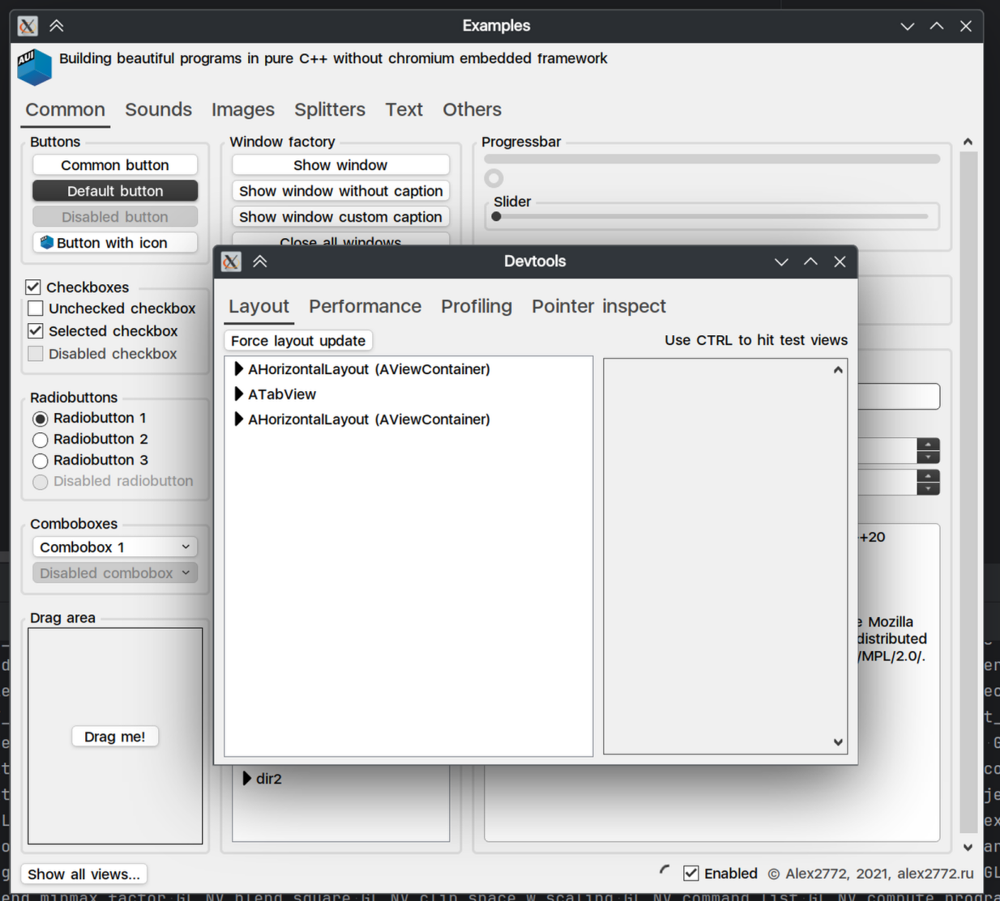
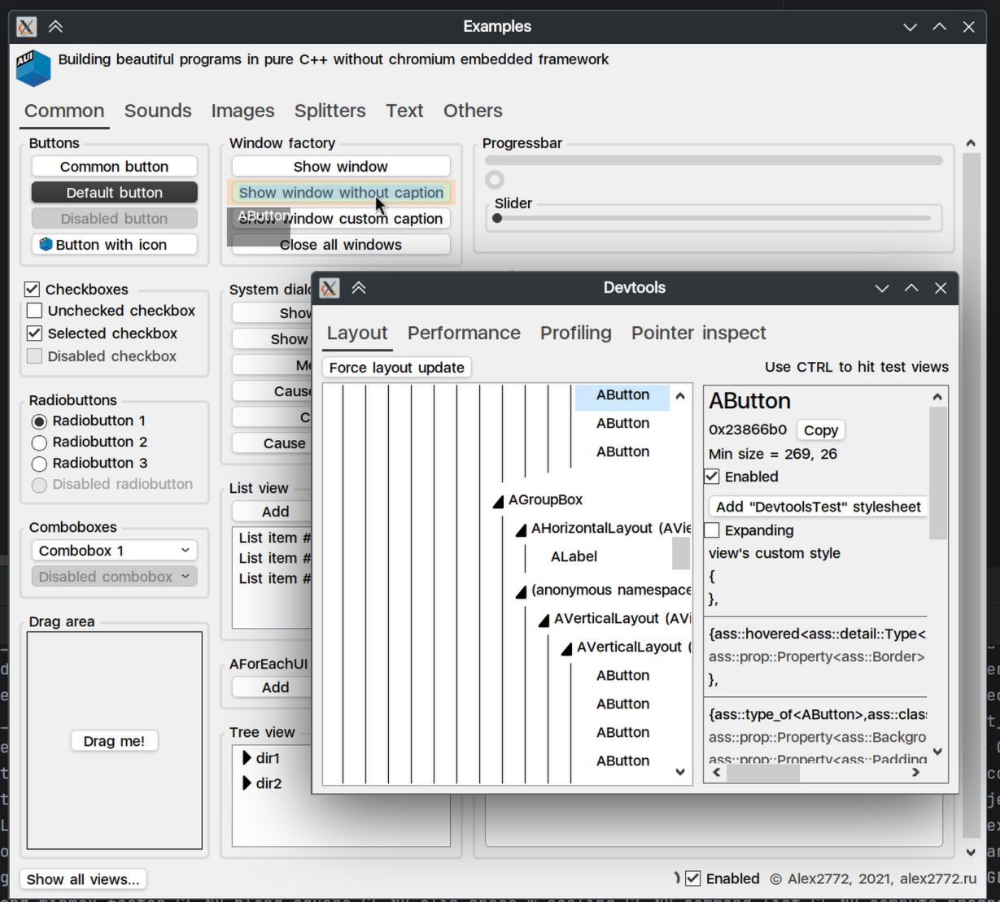

# Devtools

Devtools is a UI set of tools integrated in `aui.views` and thus in every AUI application. The devtools window can be
invoked by hitting `CTRL+SHIFT+I` or `CTRL+F12` on AUI-based application (debug only).

## Layout tab

The most notable functionality of devtools is the `Layout` tab. Here you can discover your view hierarchy and check
which [ASS](ass.md) rules were applied to your view.

You can hold `CTRL` and hover over your application to peek views:

## Show overflow

The `Other` tab has a `Show overflow` switch. When enabled, every edge where a view cuts its contents off
(`AOverflow::HIDDEN`, `AOverflow::HIDDEN_FROM_THIS`) is marked red, along with the amount of the contents that didn't
fit, in px. Views whose contents fit in are left untouched, so the marks point exactly at the places where something
is lost: a squeezed label, a container that is smaller than its children, a scroll area that has something to scroll
to.
